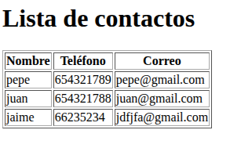
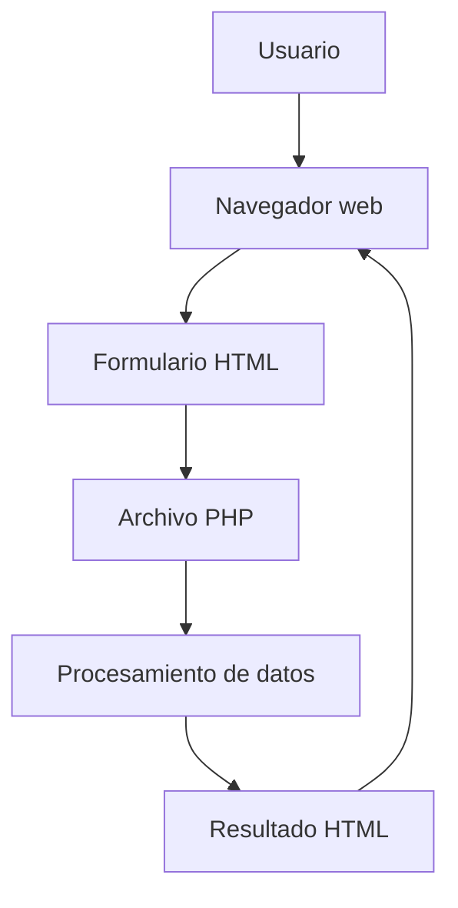

# Colección de ejercicios de la práctica 1 de PHP


Pequeña colección de ejercicios de Desarrollo de Aplicaciones Web para practicar PHP, formularios HTML, arrays, bucles, funciones y validación de datos.

## Contenido

- `presentacion.php`: muestra datos mediante variables y concatenación.
  - [Ver solución](imagenes/presentacion.png).
- `tabla.php`: genera la tabla de multiplicar de un número.
  - [Ver solución](imagenes/tabla.png).
- `alumnos.php`: recorre un array asociativo, evalúa notas y calcula la media.
  - [Ver solución](imagenes/alumnos.png).
- `registro.html` y `procesar.php`: formulario de registro y validación de los datos recibidos.
  - [Ver solución](imagenes/registro.png).
- `agenda.html` y `agenda.php`: formulario y tabla de contactos.
  - [Ver solución](imagenes/agenda.png).

## Tecnologías utilizadas

| Tecnología | Uso |
|:--|:--|
| PHP | Lógica del servidor y procesamiento de datos |
| HTML5 | Formularios y estructura de las páginas |
| Git | Control de versiones |
| Markdown | Documentación del proyecto |

## Requisitos

- PHP 8.0 o superior.
- Un terminal para ejecutar los scripts.
- Un navegador web para probar los formularios.

## Instalación y ejecución en local

1. Clona el repositorio o descarga sus archivos.
2. Abre una terminal dentro del directorio `practica1`.
3. Inicia el servidor de desarrollo de PHP:

   ```bash
   php -S localhost:8080
   ```

4. Abre `http://localhost:8080/registro.html` o `http://localhost:8080/agenda.html` en el navegador.

## Imágenes

Esta imagen enlaza con una página externa:

[](https://www.php.net/)

Esta es una imagen incluida en el repositorio:



## Tareas pendientes

- [x] Crear los ejercicios básicos de PHP.
- [x] Añadir formularios HTML.
- [x] Documentar los ejercicios en el README.
- [ ] Mejorar el diseño de los formularios.
- [ ] Añadir nuevos ejercicios de PHP.

## Avisos

> [!NOTE]
> Este proyecto se ha creado para practicar los conceptos básicos de PHP y Markdown.

> [!WARNING]
> Para ejecutar los formularios PHP es necesario iniciar un servidor PHP. No basta con abrir los archivos PHP directamente desde el navegador.

## Preguntas frecuentes

<details>
<summary>¿Qué necesito para ejecutar el proyecto?</summary>

Necesitas PHP 8.0 o superior y un navegador web.

</details>

<details>
<summary>¿Cómo inicio el servidor?</summary>

Abre una terminal en la carpeta del proyecto y ejecuta:

```bash
php -S localhost:8080
```

</details>

<details>
<summary>¿Puedo modificar los ejercicios?</summary>

Sí, puedes editar los archivos y añadir nuevos ejercicios para seguir practicando.

</details>

## Funcionamiento de la aplicación



## Documentación adicional

- [Registro de cambios](CHANGELOG.md).
- [Cómo contribuir](CONTRIBUTING.md).
- [Licencia del proyecto](LICENSE).

## Autoría

Jaime López - 2.º DAW - IES Alixar.

## Licencia

Este proyecto utiliza la licencia MIT porque permite utilizar, modificar y distribuir el código con pocas restricciones, manteniendo el aviso de copyright y la licencia.

Consulta el archivo [LICENSE](LICENSE).

---

[1]: https://www.php.net/ "Página oficial de PHP"
